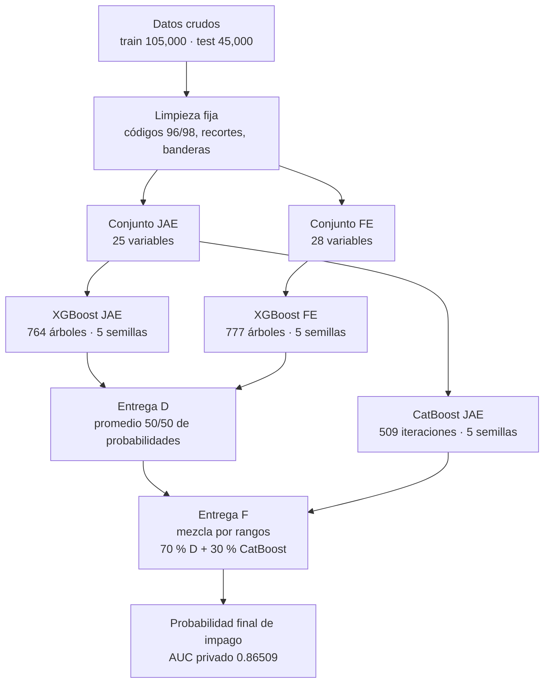

# Modelo ganador: 2.º lugar de la competencia

**Equipo Data Sapiens · 2.º lugar de 6 equipos · AUC privado 0.86509**
(entrega F, `notebooks/07_seleccion_catboost_jae.ipynb`)

## La idea en una frase

> Limpiamos los datos para que cada número signifique lo que dice, le dimos al
> modelo pistas combinadas sobre atrasos y uso de crédito, y juntamos tres
> modelos de árboles que se equivocan en clientes distintos.

## Resultado final

| Lugar | Equipo | AUC privado |
| --- | --- | --- |
| 1 | Economáquinas | 0.86567 |
| **2** | **Data Sapiens** | **0.86509** |
| 3 | Los Sub Ajustados | 0.86455 |
| 4 | Los complejos | 0.86444 |
| 5 | Gatos con sombrero | 0.86443 |
| 6 | Aprendiendo Machín | 0.86387 |

- El puntaje privado se calcula con cerca del 70 % de `test`.
- Subimos un lugar respecto a la tabla pública. Quedamos a 0.00058 del
  primer lugar y 0.00054 arriba del tercero.
- La validación cruzada ordenó nuestras entregas igual que la tabla privada.
  La tabla pública se equivocó: puso la entrega B arriba de la D.

## 1. El problema

Predecir la probabilidad de que un cliente caiga en un atraso grave (90 días o
más) en los próximos dos años (`SeriousDlqin2yrs`). Hay 105,000 clientes en
`train` y 45,000 en `test`, con 10 variables cada uno. Solo el 6.68 % cae en
impago. Se califica con AUC-ROC: qué tan bien ordena el modelo a los clientes
del más riesgoso al menos riesgoso.

## 2. Ingeniería de variables: lo esencial

### 2.1 Limpiar lo que no es lo que parece

| Problema | Qué hicimos |
| --- | --- |
| 197 clientes con 96 o 98 atrasos. No son conteos reales, son códigos de dato faltante | Se convierten en faltante y se marca la bandera `late_sentinel` (en esas filas el impago es de 57 %, contra 6.6 % en el resto) |
| Utilización de crédito de hasta 50,708 (errores de captura) | Se recorta a 2 y se marca `util_gt1` (usa más del 100 % de su línea) |
| Edad menor a 18 | Se trata como faltante |
| Atrasos con valores extremos | Se recortan a 6 |

### 2.2 Clientes sin ingreso informado

El 19.8 % de los clientes no informó su ingreso mensual. Encontramos tres
cosas:

1. **Que falte el ingreso dice algo del cliente.** Los clientes sin ingreso
   caen menos en impago (5.6 % contra 7.0 %). Por eso se guarda la bandera
   `income_missing`, y también `income_zero` y `income_placeholder` (ingreso
   igual a 1, un valor de relleno).
2. **Sin ingreso, `DebtRatio` deja de ser una razón y se vuelve un monto.**
   Cuando falta el ingreso, el 100 % de los `DebtRatio` son enteros, con
   mediana de 1,158 (contra 0.30 cuando sí hay ingreso). Con eso se construye
   una sola variable comparable para todos:
   - `debt_amount` (monto mensual de deuda) = `DebtRatio × ingreso` si hay
     ingreso; `DebtRatio` tal cual si no lo hay.
   - `debt_ratio_valid` = la razón de deuda solo cuando sí tiene sentido.
3. **Imputación del ingreso: estrategia ⭐ B.** Cuando hace falta llenar el
   ingreso, se usa la mediana del ingreso de clientes parecidos: **misma edad
   y mismo nivel de deuda** (grupo de edad × decil del monto de deuda). Para
   elegirla se ocultó el ingreso del 30 % de los clientes que sí lo tenían y
   se midió qué estrategia lo adivinaba mejor:

   | Estrategia | Mejora del error contra la mediana global |
   | --- | --- |
   | Por grupo de edad | 5.9 % |
   | 🔷 C: edad + líneas de crédito + dependientes | 9.7 % |
   | A: edad + créditos hipotecarios | 10.6 % |
   | **⭐ B: edad + decil del monto de deuda** | **16.1 %** |

   Las medianas se aprenden solo con el fold de entrenamiento, para evitar
   data leakage.

**Cómo lo usa el modelo ganador.** Los modelos de árboles (XGBoost y
CatBoost) saben manejar faltantes directamente, así que en el modelo ganador
el ingreso **se deja como faltante** y el modelo aprende solo qué hacer con él,
apoyado en `income_missing` y `debt_amount`. Se probó contra imputar con B o
con C y las diferencias quedaron dentro de ±0.0004 de AUC, es decir, ruido. La
imputación ⭐ B se usa en la regresión logística, que no acepta faltantes.

### 2.3 Variables combinadas (interacciones)

Las variables que más usa el modelo son combinaciones de atrasos y uso de
crédito:

| Variable | Qué mide | Peso en el modelo |
| --- | --- | --- |
| `late_x_util` | Atrasos × utilización: el que se atrasa **y** tiene la tarjeta al tope | 1.º lugar (≈ 28 % de la ganancia) |
| `late_severity` | Atrasos ponderados por gravedad (30, 60 y 90 días valen 1, 2 y 3) | 2.º lugar (≈ 19 %) |
| `max_late` | El peor tipo de atraso registrado | 3.er lugar (≈ 15 %) |
| `age_x_util` | Edad × utilización: a igual uso, los jóvenes son más riesgosos | 9.º lugar |

### 2.4 Menos es más: de 27 a 25 variables

Se probó quitar una variable a la vez. Quitar `disposable_income_clip`
(ingreso − deuda) y `total_late` (total de atrasos) **mejoró** el modelo
(+0.00022) porque repetían información de otras variables. Así, cada árbol ve
más seguido las variables que sí aportan.

Las 25 variables finales:

- **Atrasos:** `late_30_59`, `late_60_89`, `late_90`, `max_late`,
  `late_severity`, `late_sentinel`.
- **Uso de crédito:** `util_clip`, `util_gt1`, `util_zero`.
- **Interacciones:** `late_x_util`, `age_x_util`, `non_re_lines`.
- **Ingreso y deuda:** `income_clip`, `per_dependent_income_clip`,
  `debt_amount`, `debt_ratio_valid`, `income_missing`, `income_zero`,
  `income_placeholder`.
- **Perfil:** `age`, `open_lines`, `real_estate`, `dependents`,
  `dependents_missing`, `thin_file`.

## 3. Flujo del ensamble

Paso a paso:

1. **Dos versiones de las variables.** El conjunto JAE (25 variables) y el
   conjunto FE (28 variables, `features.prepare()`) describen al cliente de
   forma parecida pero no idéntica.
2. **Dos XGBoost, uno por conjunto.** Cada uno se entrena con 5 semillas
   distintas y se promedian, para que el resultado no dependa de la suerte.
3. **Entrega D:** promedio 50/50 de las probabilidades de los dos XGBoost.
4. **CatBoost** sobre las 25 variables JAE, también con 5 semillas.
5. **Entrega F:** cada modelo ordena a los clientes del 1 al 45,000 y se
   combinan esas posiciones: 70 % el orden de D y 30 % el de CatBoost.

## 4. Características principales del ensamble

| Característica | Detalle | Por qué |
| --- | --- | --- |
| Modelos | 2 XGBoost + 1 CatBoost (gradient boosting con árboles) | Los árboles capturan relaciones en forma de "U" e interacciones sin transformarlas a mano |
| Hiperparámetros de XGBoost | `learning_rate` 0.01, `max_depth` 6, `subsample` 0.6, `colsample_bytree` 0.7, `reg_lambda` 10, `min_child_weight` 10, `gamma` 0.5 | Tasa de aprendizaje lenta y regularización fuerte para no sobreajustar |
| Hiperparámetros de CatBoost | `learning_rate` 0.05, `depth` 6, `l2_leaf_reg` 5; iteraciones elegidas con early stopping | Árboles simétricos y otro esquema de boosting: se equivoca en clientes distintos |
| Promedio de semillas | 5 semillas por modelo (985, 1, 2, 3, 4) | Reduce la variación aleatoria |
| Diversidad | Spearman entre XGBoost ≈ 0.998; entre CatBoost y D = 0.9865 | Mezclar modelos solo ayuda si se equivocan distinto |
| Mezcla por rangos | Se combinan las posiciones, no las probabilidades | El AUC solo mide el orden; así ningún modelo domina por su escala |
| Peso de CatBoost | 30 % | Mejor punto en la partición del equipo que también se sostuvo en una partición independiente (semilla 2024) |
| Validación | 5 folds estratificados, siempre los mismos para todo el equipo | Comparaciones justas entre experimentos |

**Detalle importante:** CatBoost solo es **peor** que el XGBoost JAE (0.86618
contra 0.86675), pero dentro de la mezcla mejora el resultado en los 5 folds.
Lo que aporta es que se equivoca en otros clientes.

## 5. ¿Cuánto aportó cada paso?

| Paso | AUC validación cruzada | AUC privado |
| --- | --- | --- |
| XGBoost 2b (un solo modelo) | 0.86586 | 0.86411 |
| Entrega B: + semillas + mezcla con FE | 0.86663 | 0.86463 |
| Entrega D: + interacciones y selección (25 variables) | 0.86676 | 0.86476 |
| **Entrega F: + 30 % CatBoost** | **0.86698** | **0.86509** |

Cada paso mejoró tanto en la validación cruzada como en la tabla privada, y
en el mismo orden. Las mejoras medidas en casa se sostuvieron con datos que
nunca vimos.

## 6. Tres lecciones

1. **Entender los datos valió más que complicar el modelo.** Los códigos
   96/98, el `DebtRatio` que en realidad es un monto y el ingreso faltante
   como señal salieron del EDA, no del modelo.
2. **Mezclar modelos distintos rinde más que perfeccionar uno solo.** Treinta
   configuraciones de XGBoost no superaron a la 2b; agregar CatBoost sí ayudó.
3. **Confiar en la validación cruzada, no en la tabla pública.** La tabla
   pública tiene ruido de 0.004 a 0.006 de AUC. La validación cruzada predijo
   bien el orden final.

## 7. Explicación de 30 segundos

> «Nuestro modelo estima la probabilidad de que un cliente deje de pagar.
> Primero limpiamos los datos: había códigos que parecían atrasos y no lo eran,
> y descubrimos que, para quien no reporta ingreso, la razón de deuda en
> realidad es el monto que debe. Luego creamos variables que combinan los
> atrasos con el uso de la tarjeta, que fueron las más útiles. Al final
> juntamos tres modelos de árboles, dos XGBoost y un CatBoost, que se
> equivocan en clientes distintos; al combinarlos se corrigen entre sí. Con
> eso quedamos en segundo lugar.»

## Evidencia

| Qué | Dónde |
| --- | --- |
| Entrega F completa y reproducible | `notebooks/07_seleccion_catboost_jae.ipynb` |
| Ingeniería de variables | `src/features/engineering_jae.py`, `docs/plan_ingenieria_variables.md` |
| Imputación del ingreso (comparación de estrategias) | `notebooks/02_eda.ipynb` (sección 10.3 d), `notebooks/03_ingenieria_variables_jae.ipynb` |
| Interacciones y su peso en el modelo | `notebooks/06_interacciones_jae.ipynb` |
| Decisión de usar CatBoost | `docs/adr/0001-catboost.md` |
| Historial de experimentos | `reports/experiments.csv` |
